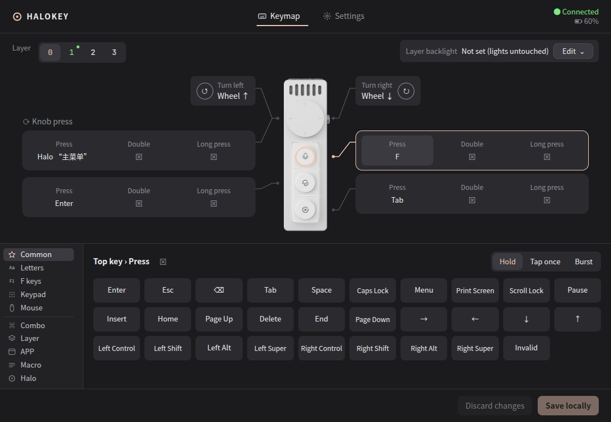

# HaloKey

> 🌐 [中文](README.zh.md) · [日本語](README.ja.md)

Cross-platform, open-source control center for the Ulanzi Vibe Key (AU05): remap the three keys and the knob, run host-side actions, pick from a radial on-screen menu, and manage lighting, microphone and power settings. One codebase for Linux, macOS and Windows.

**Status: pre-alpha.** On Linux the whole chain runs: protocol, transport, host model, headless daemon, tray app with a settings window and the halo overlay. The macOS and Windows backends compile but have not run on hardware.

## Try it now



Requires a Rust toolchain (`rustup`). On Linux, copy `packaging/linux/70-halokey.rules` to `/etc/udev/rules.d/` and replug the receiver, or temporarily `chmod a+rw /dev/hidraw*`.

```sh
cargo run -p halokey-cli -- list                 # find the receiver's vendor channel
cargo run -p halokey-cli -- status               # online state, battery, voltage
cargo run -p halokey-cli -- keys                 # the six on-device key slots
cargo run -p halokey-cli -- monitor --heartbeat  # decode vendor events while you press keys
cargo run -p halokey-cli -- set-key 0 kb 0x68    # write key 1 = F13, then read back (persists on the device)
cargo run -p halokey-cli -- run -v               # daemon: heartbeat, gestures, uinput injection (needs /dev/uinput)
cargo run -p halokey-cli -- export-keymap > my.json   # the device table as editable host keymap JSON
cargo run -p halokey-cli -- run --config docs/examples/knob-moves-pointer.json   # knob moves the mouse pointer
cargo run -p halokey-cli -- run --config docs/examples/switch-apps-and-macro.json # keys switch apps, knob press runs a macro
cd ui && npm install && npm run dev              # once / in a second terminal: dev builds load the Vite dev server
cargo run -p halokey-app --no-default-features   # tray app (dev: loads the Vite server; drop the flag to embed ui/dist): settings window + halo overlay, reads ~/.config/halokey/keymap.json
```

`docs/examples/halo-menu.json` puts a two-level halo menu on the knob press; copy it to `~/.config/halokey/keymap.json` or paste it into the settings window.

To install on Debian/Ubuntu, use the `.deb` from the GitHub Releases page (x86_64 and arm64), or build it locally: `cargo tauri build --bundles deb --no-sign` in `apps/halokey`, then `sudo dpkg -i target/release/bundle/deb/halokey_*.deb` and replug the receiver so the bundled udev rule applies. AppImage is not built: it cannot install the udev rule.

To install on macOS, use the `.dmg` from the GitHub Releases page (Apple silicon and Intel), or build it locally: `cargo tauri build --bundles dmg` in `apps/halokey`, then open the `.dmg` from `target/release/bundle/dmg/`. Drag HaloKey into Applications. Release builds are signed with HaloKey's own self-signed certificate, not an Apple Developer ID, and local builds are ad-hoc signed. Neither is notarized, so the first launch of a downloaded copy is blocked: open System Settings → Privacy & Security and click Open Anyway. HaloKey then asks for Accessibility permission, which it needs to send keys and mouse events; allow it under Privacy & Security → Accessibility, wait a couple of seconds, then press a key and it takes effect, no restart needed. The app lives in the menu bar, not the Dock.


The Settings page writes lighting, power, microphone and the device's own key table directly, and can import / export the keymap file or rebuild it from the device.

The device render in the settings window (`ui/public/device.png`) comes from the [Open VibeKey](https://github.com/palaemonboy/OpenVibeKey) repository (MIT).

`set-key` writes the device's own table. Pick a slot you can afford to break first, and note the old value it prints.

## Why another one

Ulanzi Studio supports only Windows and macOS. Every community project so far is either macOS-only or Linux-only, and none of them offers the radial menu that Studio has. HaloKey starts over on Rust and Tauri 2 so that the device logic is written once and only thin platform adapters differ.

## Planned features

| Feature | State |
|---|---|
| Vendor channel (TEA-encrypted HID, report ID `0x55`) | **done**: `halokey-proto` + `halokey-hid`, verified on Linux `hidraw` |
| Key and knob remapping, layers, single / double / long press | **done** in `halokey-host`, ported from olanzi with its tests |
| Host actions: keyboard, mouse buttons, wheel, pointer movement, app switching, macros, shell | all but shell commands work on Linux X11 via `halokey run`; shell commands are planned |
| Radial "halo" menu: an eight-option overlay driven by the knob | **done** on Linux: `halos` in the keymap, nested menus, verified on GNOME/X11 |
| Lighting, noise reduction, standby timeouts, battery readout | **done**: lighting, noise reduction, microphone switch, standby and sleep delays, battery, versions; plus an idle handoff so the unit can actually sleep |
| Tray / menu bar icon, launch at login, auto-update | **done** (`apps/halokey`, Tauri 2): tray icon, settings window, login autostart; installed builds check for updates, notify, and install after you confirm |

## Updates and releases

Installed builds (Linux deb, macOS .app, Windows NSIS/MSI) check `https://github.com/jiangzhuo/halokey/releases/latest/download/latest.json` 30 seconds after start and every 6 hours. This is on by default and can be turned off in Settings ("Check for updates automatically"); a "Check for updates" button checks on demand. Each new version brings one system notification; while it is available, the tray also shows an "Install update vX.Y.Z…" item and Settings → Updates shows it with a release-notes link. After you confirm, HaloKey downloads the update, verifies its signature, installs it and restarts. Builds run from source (`cargo run`, `target/*/halokey-app`) never check for updates. The tray menu and the notification follow the interface language.

- Linux deb updates ask for the administrator password once (a system authorization dialog). If you cancel it, the updater plugin may ask again with a fallback prompt and then report a failed install rather than "cancelled".
- macOS release builds are signed with HaloKey's own self-signed certificate, so macOS keeps the Accessibility permission across updates. The exception is the one update from v0.1.1 or earlier, which were ad-hoc signed: macOS treats the new build as a different app, and the old entry still looks enabled in System Settings but no longer works. If the keys or the knob stop working after that update, remove HaloKey from System Settings → Privacy & Security → Accessibility and add it again. Locally built apps are ad-hoc signed and need the same after every rebuild.
- The first release that contains the updater is the baseline; anything installed before it has to be updated manually once.

To release (maintainers): bump the version in `apps/halokey/tauri.conf.json` and the root `Cargo.toml` (`[workspace.package] version`), commit, and push a `vX.Y.Z` tag. CI checks the tag against both versions and the release job fails if they differ, so bump both and commit before tagging. CI builds signed deb (x86_64, arm64), macOS .app/.dmg (arm64, x86_64) and Windows NSIS/MSI, generates `latest.json` and creates a draft release. Check the draft on GitHub and publish it; users only receive the update after it is published. macOS builds are signed with the certificate in the `MACOS_SIGNING_CERT` and `MACOS_SIGNING_CERT_PASSWORD` repository secrets. Keep that certificate: a different one makes every macOS user grant Accessibility again, so the workflow pins its SHA-1 and fails if it changes. Local `cargo tauri build` fails without `TAURI_SIGNING_PRIVATE_KEY` because update artifacts are on; add `--no-sign` for local builds (it skips the update signature, fine for local use).

## Platform matrix

| Component | Linux | macOS | Windows |
|---|---|---|---|
| HID transport | `hidraw` via hidapi | IOKit via hidapi | Win32 HID via hidapi |
| Input injection | uinput (done) | CGEvent (compile-checked, untested) | SendInput (compile-checked, untested) |
| App switching | X11 EWMH (done); under Wayland only XWayland clients | NSWorkspace + `open` (compile-checked) | SetForegroundWindow (compile-checked) |
| Overlay window | X11 ready; GNOME Wayland works, placed by the compositor | non-activating panel | no-activate window |

## Repository layout

```text
crates/proto     TEA, frame codec, command table, key table – pure, heavily unit-tested
crates/hid       hidapi transport, heartbeat, hotplug
crates/host      keymap model, gesture router, macros, action runner
crates/input     uinput / CGEvent / SendInput backends
crates/wm        app switching backends
crates/runtime   device service thread shared by the CLI and the app
apps/halokey     Tauri 2 shell: tray, settings window, halo overlay
docs/            design and protocol notes, English default with `.zh.md` twins
tools/           repository checks
```

## Acknowledgements

HaloKey builds on the work of these projects, all MIT-licensed. [THIRD_PARTY_NOTICES.md](THIRD_PARTY_NOTICES.md) keeps the license notices for the material HaloKey includes.

- [olanzi](https://github.com/MrCroxx/olanzi) by Croxx: the reverse-engineering record of the AU05 protocol and a native macOS app. HaloKey's protocol knowledge comes from its documentation; the gesture router, action runner and key bridge are ported from it together with their tests; the keymap format is derived from it (files are not interchangeable); the macOS virtual key table and the hardware evidence used in the protocol tests also come from it.
- [vibed](https://github.com/ihavespoons/vibed) by Ben Gittins: a macOS daemon for the Vibe Key. HaloKey relies on what it recovered from the vendor SDK: the mouse-page entry types (confirmed on hardware), the power, microphone and standby commands, and the lighting work-duration value.
- [Open VibeKey](https://github.com/palaemonboy/OpenVibeKey) by palaemonboy: a macOS customization app for the AU05. The device render in the settings window comes from it.

HaloKey is an independent community project. It is not affiliated with or endorsed by Ulanzi or Kehwin, and it does not include or load any vendor binaries.

## Documentation

| # | Document | Content |
|---|---|---|
| 01 | [Architecture](docs/01-architecture.md) | crates, platform adapters, overlay, known risks |
| 02 | [Protocol Notes](docs/02-protocol-notes.md) | what HaloKey measured beyond the olanzi record |
| 03 | [Configuration Format](docs/03-config-format.md) | the keymap JSON: controls, actions, layers, halos |

Every document exists in English (default filename) and Chinese (`.zh.md`); `python3 tools/check_docs.py` verifies that the pairs stay in sync.

## License

[MIT](LICENSE)
