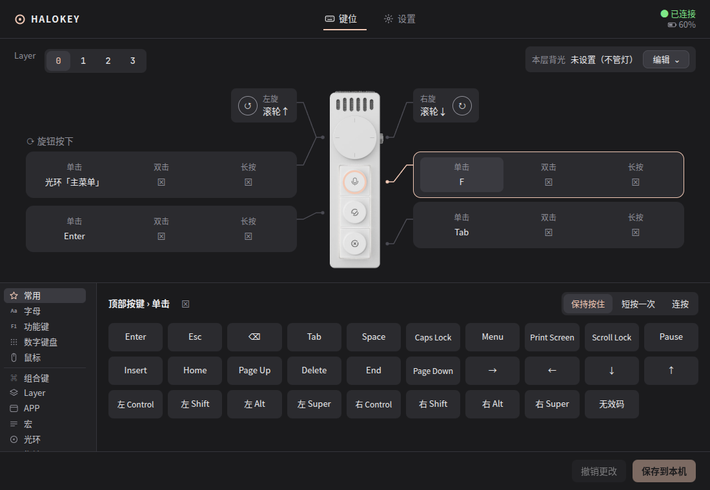
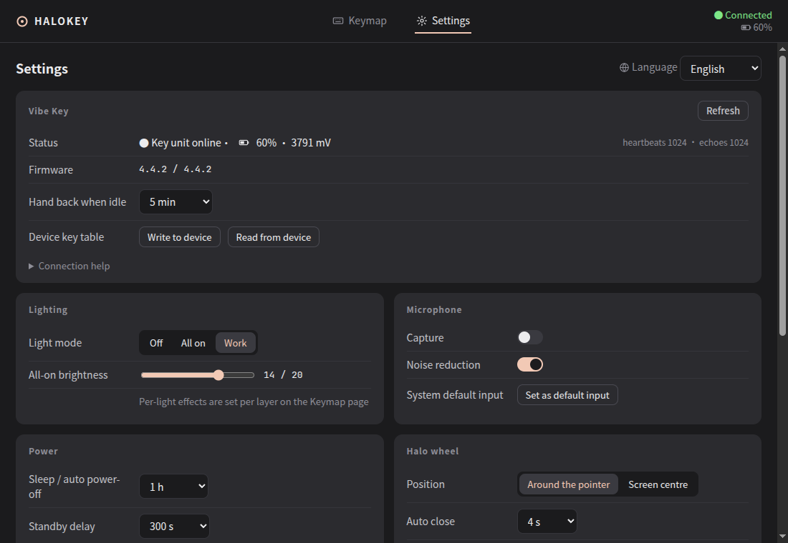

# halokey

> 🌐 [English](README.md)

Ulanzi Vibe Key（AU05）的跨平台开源控制中心：重映射三个按键和旋钮，执行主机侧动作，用屏幕上的环形菜单做选择，管理灯光、麦克风和电源设置。一套代码覆盖 Linux、macOS 和 Windows。

**状态：pre-alpha。** Linux 上整条链路已经跑通：协议、传输、主机模型、无界面守护进程、带设置窗口和光环悬浮层的托盘应用。macOS 与 Windows 后端已能编译，但没在真机上跑过。

## 现在就能试



需要 Rust 工具链（`rustup`）。Linux 上把 `packaging/linux/70-halokey.rules` 复制到 `/etc/udev/rules.d/` 后重新插拔接收器，或临时 `chmod a+rw /dev/hidraw*`。

```sh
cargo run -p halokey-cli -- list                 # 找到接收器的厂商通道
cargo run -p halokey-cli -- status               # 在线状态、电量、电压
cargo run -p halokey-cli -- keys                 # 设备端六个按键格
cargo run -p halokey-cli -- monitor --heartbeat  # 按键时解码厂商事件
cargo run -p halokey-cli -- set-key 0 kb 0x68    # 把键 1 写成 F13 并读回（持久化在设备里）
cargo run -p halokey-cli -- run -v               # 守护进程：心跳、手势、uinput 注入（需要 /dev/uinput）
cargo run -p halokey-cli -- export-keymap > my.json   # 设备表导出为可编辑的主机键位 JSON
cargo run -p halokey-cli -- run --config docs/examples/knob-moves-pointer.json   # 旋钮移动鼠标指针
cargo run -p halokey-cli -- run --config docs/examples/switch-apps-and-macro.json # 按键切换应用，旋钮按下跑宏
cd ui && npm install && npm run dev              # 安装一次 / 另开终端常驻：开发版加载 Vite 开发服务器
cargo run -p halokey-app --no-default-features   # 托盘应用（开发：加载 Vite；去掉参数则嵌入 ui/dist）：设置窗口 + 光环悬浮层，读取 ~/.config/halokey/keymap.json
```

`docs/examples/halo-menu.json` 把一个两级光环菜单放在旋钮按下上；复制到 `~/.config/halokey/keymap.json`，或粘贴进设置窗口。

Debian/Ubuntu 安装：用 GitHub Releases 里的 `.deb`（x86_64 和 arm64），或本地构建：在 `apps/halokey` 里 `cargo tauri build --bundles deb --no-sign`，然后 `sudo dpkg -i target/release/bundle/deb/halokey_*.deb`，重新插拔接收器让自带的 udev 规则生效。不再构建 AppImage：它装不了 udev 规则。

macOS 安装：在 `apps/halokey` 里 `cargo tauri build --bundles dmg`，打开 `target/release/bundle/dmg/` 里的 `.dmg`，把 halokey 拖进「应用程序」。应用是 ad-hoc 签名、没有公证，下载来的副本第一次启动会被拦下：打开「系统设置 → 隐私与安全性」，点「仍要打开」。之后 halokey 会请求辅助功能权限（发送按键和鼠标事件需要它）：在「隐私与安全性 → 辅助功能」里允许后，等两三秒再按一下键就会生效，不用重启。应用只在菜单栏显示，不占 Dock。



设置页可直接写灯光、电源、麦克风与设备自身键位，也能导入 / 导出键位文件或从设备重建。

设置窗口里的设备渲染图（`ui/public/device.png`）来自 [Open VibeKey](https://github.com/palaemonboy/OpenVibeKey) 仓库（MIT）。

`set-key` 改的是设备自己的表。先挑一个改坏也没关系的格子，并记下它打印的旧值。

## 为什么再做一个

Ulanzi Studio 只支持 Windows 和 macOS。目前所有社区项目要么只做 macOS，要么只做 Linux，而且没有一个实现了 Studio 的环形菜单。halokey 用 Rust 和 Tauri 2 重新开始，设备逻辑只写一遍，平台之间只差薄薄的适配层。

## 计划功能

| 功能 | 状态 |
|---|---|
| 厂商通道（TEA 加密 HID，report ID `0x55`） | **已完成**：`halokey-proto` + `halokey-hid`，在 Linux `hidraw` 上验证 |
| 按键与旋钮重映射、分层、单击 / 双击 / 长按 | **已完成**：`halokey-host`，连同测试从 olanzi 移植 |
| 主机侧动作：键盘、鼠标按键、滚轮、指针移动、切换应用、宏、shell | 除 shell 命令外都已在 Linux X11 上通过 `halokey run` 可用；shell 命令计划中 |
| 环形"光环"菜单：由旋钮驱动的八选项悬浮层 | **已完成**（Linux）：键位里的 `halos`，支持多级，在 GNOME/X11 上验证 |
| 灯光、降噪、待机时间、电量读取 | **已完成**：灯光、降噪、麦克风开关、待机与休眠延时、电量、版本；另有空闲交还让本体真能待机 |
| 托盘 / 菜单栏图标、登录启动、自动更新 | **已完成**（`apps/halokey`，Tauri 2）：托盘图标、设置窗口、登录启动；安装版会检查更新、提醒，确认后自动安装 |

## 更新与发版

安装版（Linux deb、macOS .app、Windows NSIS/MSI）在启动 30 秒后以及之后每 6 小时检查一次 `https://github.com/jiangzhuo/halokey/releases/latest/download/latest.json`。默认开启，可在设置里关闭（「自动检查更新」）；也可点「检查更新」手动检查。每个新版本只发一次系统通知；有新版本期间，托盘里会出现「安装更新 vX.Y.Z…」，设置页的「更新」一节也会显示它（带「发布说明」链接）。确认后 halokey 下载更新、校验签名、安装并重启。从源码运行的版本（`cargo run`、`target/*/halokey-app`）从不检查更新。托盘菜单和通知跟随界面语言。

- Linux deb 更新会要求输入一次管理员密码（系统授权对话框）。如果取消，更新插件可能再次以备用提示询问，最后报告安装失败，而不是"已取消"。
- macOS 构建没有用 Apple Developer ID 签名，所以更新后 macOS 可能不再认可之前授予的辅助功能权限，即使系统设置里看起来仍是开启的。如果更新后按键或旋钮没有反应，在 系统设置 → 隐私与安全性 → 辅助功能 里移除 halokey 再重新添加。
- 第一个带更新功能的版本是基线；更早安装的版本需要手动更新一次。

发版（维护者）：修改 `apps/halokey/tauri.conf.json` 与根 `Cargo.toml`（`[workspace.package] version`）的版本，提交，推 `vX.Y.Z` 标签。CI 会把标签与这两处版本对照，不一致则发布任务失败，所以要先同时改好两处并提交，再打标签。CI 会构建已签名的 deb（x86_64、arm64）、macOS .app/.dmg（arm64、x86_64）和 Windows NSIS/MSI，生成 `latest.json` 并创建草稿 release。在 GitHub 上检查草稿并发布；发布之后用户才会收到更新。因为开启了更新产物，本地 `cargo tauri build` 没有 `TAURI_SIGNING_PRIVATE_KEY` 会失败；本地构建加 `--no-sign`（跳过更新签名，本地使用没问题）。

## 平台矩阵

| 组件 | Linux | macOS | Windows |
|---|---|---|---|
| HID 传输 | hidapi 走 `hidraw` | hidapi 走 IOKit | hidapi 走 Win32 HID |
| 输入注入 | uinput（已完成） | CGEvent（仅编译检查，未实测） | SendInput（仅编译检查，未实测） |
| 切换应用 | X11 EWMH（已完成）；Wayland 下只认 XWayland 客户端 | NSWorkspace + `open`（仅编译检查） | SetForegroundWindow（仅编译检查） |
| 悬浮窗 | X11 可用；GNOME Wayland 可用，位置由合成器安排 | 不抢焦点的面板 | 不激活的窗口 |

## 仓库布局

```text
crates/proto     TEA、帧编解码、命令表、键码表 – 纯逻辑，重点单元测试
crates/hid       hidapi 传输、心跳、热插拔
crates/host      键位模型、手势路由、宏、动作执行
crates/input     uinput / CGEvent / SendInput 后端
crates/wm        切换应用后端
crates/runtime   命令行与桌面应用共用的设备服务线程
apps/halokey     Tauri 2 外壳：托盘、设置窗、光环悬浮层
docs/            设计与协议笔记，英文为默认，`.zh.md` 为中文版
tools/           仓库检查脚本
```

## 与其他项目的关系

- [olanzi](https://github.com/MrCroxx/olanzi) 保存着逆向记录和一个原生 macOS 应用；halokey 复用它的协议文档，键位格式由它衍生（文件不互通）。
- [vibed](https://github.com/ihavespoons/vibed) 记录了从厂商 SDK 恢复的鼠标页条目类型，halokey 已在真机上确认。

halokey 是独立的社区项目，与 Ulanzi 或 Kehwin 无关联、未获其背书，不包含也不加载任何厂商二进制。

## 文档

| # | 文档 | 内容 |
|---|---|---|
| 01 | [架构](docs/01-architecture.zh.md) | crate 划分、平台适配、悬浮层、已知风险 |
| 02 | [协议笔记](docs/02-protocol-notes.zh.md) | halokey 在 olanzi 记录之外实测的内容 |
| 03 | [配置格式](docs/03-config-format.zh.md) | 键位 JSON：控件、动作、层、光环 |

每份文档都有英文版（默认文件名）和中文版（`.zh.md`）；`python3 tools/check_docs.py` 负责检查两版是否同步。

## 许可证

[MIT](LICENSE)
